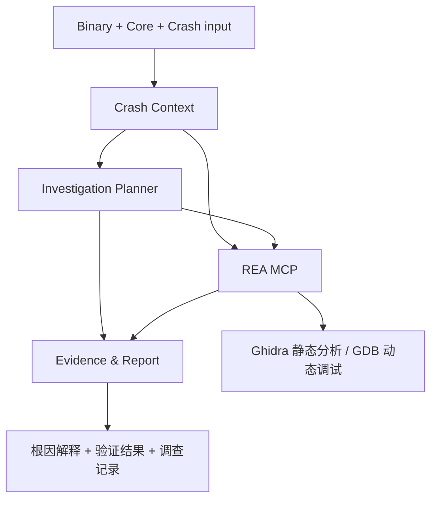

# Crash2RE 项目说明与当前结论

## 1. 我们正在做什么

Crash2RE 的研究问题是：

> 给定一个 stripped Linux ELF、触发崩溃的输入和 Core Dump，LLM Agent 能否围绕 Crash 自主选择分析目标、恢复相关程序逻辑、识别真正根因，并通过实验验证自己的判断？

输入包括：

- Stripped Linux ELF binary
- Crash-inducing input
- Core Dump（可选，但当前评测会提供）

期望输出包括：

- Crash location 和异常指令
- Relevant functions、基本块和调用关系
- 与 Crash 有关的跨函数参数、返回值和对象状态
- Reconstructed program logic
- Root cause explanation
- Supporting Evidence、被排除的替代假设和验证结果

Crash2RE 的重点不是让模型简单阅读反编译代码，而是研究模型能否像逆向工程师一样决定下一步分析什么、缺少什么证据，以及如何通过动态实验区分竞争假设。

## 2. REA 与 Crash2RE 的关系

REA 是分析工具和 Evidence 底座，Crash2RE 是崩溃调查策略。

REA 已经提供：

- `inspect_recorded_crash`：读取 Linux ELF Core，恢复信号、线程、寄存器和记录的内存映射事实。
- `open_binary`、`analyze_function`、`procedure_pseudo_code`：恢复函数、调用关系、基本块和伪代码。
- `trace_native_values`：追踪部分静态值依赖和跨函数关系。
- `start_gdb_session`、`gdb_console`：运行目标、设置断点、查看内存和寄存器，以及实施受控干预。
- Evidence ledger 和 bundle：保存工具输入、输出、目标身份、来源和限制。

Crash2RE 负责：

- 从 Crash facts 选择需要分析的函数和代码区域。
- 维护多个竞争根因假设。
- 判断静态证据是否足够，以及何时需要 GDB。
- 为动态实验写出预测和停止条件。
- 根据新证据支持或反驳假设。
- 在预算内停止，并区分 observed、derived、inferred 和 unknown。

因此，Crash2RE 并不是因为 REA 完全无法分析 Crash 才出现。REA 已经具有大部分分析原语，但没有提供一个完成“定位 → 假设 → 取证 → 反驳 → 验证 → 根因报告”的专用自主 Crash Agent。

## 3. REA 已有的相近能力和 Demo

REA 有真实 Core Dump 验证流程：`npm run verify:recorded:crash` 会构建测试程序、产生真实 Core，并通过 CLI/MCP 验证 Core 解析结果。它验证的是线程、信号、寄存器、映射、错误处理和资源生命周期，不会继续自主追查根因。

REA 也有真实 LLM Agent 评测：`npm run verify:agent` 会在隔离环境中启动 Codex，让它面对未知 native、managed 和 Electron artifact，自主选择 REA 工具并输出 Evidence。当前 native 场景要求解释静态 artifact，并明确禁止执行目标；它不提供 Core，也不评估 Crash 根因。

REA 的 runtime skill 已经建议：从静态 Evidence 选择函数或假设，再使用 GDB、Frida 或 process capture 回答动态问题。但这属于工具使用指导，不是一个现成的 Crash 根因控制器。

当前仓库没有发现一个完整 Demo 同时完成以下所有步骤：

1. 接收未知 stripped binary、Crash input 和 Core。
2. 自主定位 Crash 并选择相关函数。
3. 生成和维护多个根因假设。
4. 自主设计 GDB 实验。
5. 排除替代假设。
6. 输出经过验证的根因报告。

## 4. 已完成的能力实验

我们通过 REA 公共 MCP 工具实际调查了两个简单的 stripped x86-64 ELF。

### Case 01：未检查的空指针返回值

- Core 显示 `SIGSEGV`、`RIP=0x401186`、`RAX=0`。
- `analyze_function` 将 Crash 映射到函数 `0x401176`，该函数解引用参数。
- 上游函数 `0x401136` 对输入检查 `OK:` 前缀；不满足时返回 `NULL`。
- 调用者 `0x401193` 将返回值直接传给 consumer，没有检查。
- 静态证据支持根因：失败返回值未检查，随后发生空指针解引用。
- 本次调查没有做动态验证。

### Case 02：延迟发生的相邻字段覆盖

- Core 显示 `SIGSEGV`、`RIP=0x40120f`，被解引用的寄存器值为输入字节构成的 `0x504f4e4d4c4b4a49`。
- Ghidra 恢复了 initializer、copy、consumer 和 caller。
- 对象前 8 字节是缓冲区，偏移 8 处是指针；copy 函数错误地允许复制整个 16 字节对象的大小。
- `trace_native_values` 能连接函数和部分参数，但不能单独证明内存别名和覆盖来源。
- GDB 在 `memcpy` 前观察到指针有效，在复制后观察到指针被输入 `IJKLMNOP` 覆盖。
- 使用相同输入，只将复制长度从 16 改为 8 后，指针保持有效且程序正常退出。
- “指针未初始化”假设被反驳；“复制覆盖相邻指针”得到动态证据支持。

这些实验说明 REA 工具链可以支持简单 Crash 的完整调查。由于调查者知道样例设计，它们是能力探索，不是自主 Agent 盲测结果。

## 5. 当前 REA 能力判断

| Capability | 当前判断 | 主要限制 |
|---|---|---|
| Function Recovery | 在两个简单案例中支持 | 优化、间接调用和混淆程序尚未验证 |
| Code Understanding | 支持局部和简单跨函数语义恢复 | 伪代码不是原始源码或程序意图证明 |
| Crash Analysis | 部分支持 | Core 调用栈、完整线程关联和 binary/core 身份绑定有限 |
| Crash-to-Code Mapping | 部分支持 | 静态 caller 是可能路径，不是实际 Crash 栈；PIE/ASLR 仍需系统评测 |
| Cross-function Data Flow | 部分支持 | 通用内存别名、对象字段 provenance 和延迟破坏仍需动态证据 |
| Root Cause Analysis | 工具链可支持，需 Agent 或调查者组织 | REA 本身不会自动维护假设、选择实验或判断因果性 |

当前最可能需要继续改进的底层能力包括：

- Core 调用栈恢复和 Crash 时实际调用链。
- PIE/ASLR 下 Core 地址与静态 image 的可靠映射。
- Binary 与 Core 的可靠身份绑定。
- 跨函数内存对象和字段 provenance。
- 更直接的 Crash context 到相关代码切片工作流。

是否修改 REA 应由盲测失败证据决定。如果模型能够使用现有工具解决问题，就不需要为了 Crash2RE 预先增加新工具。

## 6. 为什么先做“直接提示词”基线

最简单的 Crash2RE 形态就是：给安装了 REA skill 的 Codex 一段明确提示词，让它自主调用现有工具。

建议的基线任务要求：

> 给定 stripped ELF、Core Dump 和 Crash input，使用 REA 定位崩溃，恢复相关函数和跨函数数据流，提出至少两个合理根因假设，收集支持和反对证据；必要时通过 GDB 做有预测的受控实验；最后输出 Crash location、相关函数、程序逻辑、根因、验证结果、Evidence IDs 和未知事项。

直接提示词可能已经能够完成未知程序的调查。因此实验顺序应当是：

1. 普通任务提示词：测量 Codex + REA 的原生表现。
2. 结构化提示词：强制记录假设、预测、Evidence 和停止条件。
3. 只有在前两种方式反复表现出稳定缺陷时，再实现专用 Crash2RE controller。

需要 controller 的可能证据包括：过早停止在 Crash site、只保留一个假设、无法根据结果调整下一步、没有执行因果验证、超出工具预算，或无法维护 Evidence 引用和资源生命周期。

如果直接提示词在盲测中已经稳定成功，研究贡献应转向 Crash investigation policy、验证策略和评测方法，而不是为了形式上的 Agent 架构增加复杂度。

## 7. 已完成的评测基础设施

目前有四个 stripped ELF x86-64 synthetic cases：

| Case | 用途 | Build | Crash 类型 | 目标能力 |
|---|---|---|---|---|
| 01 | Development | `-O0`, non-PIE | `SIGSEGV` | 未检查的失败返回值 |
| 02 | Development | `-O0`, non-PIE | `SIGSEGV` | 延迟的相邻字段覆盖 |
| 03 | Evaluation | `-O2`, PIE | `SIGFPE` | 跨函数数值前置条件 |
| 04 | Evaluation | `-O2`, PIE | `SIGABRT` | 分配指针 provenance 和错误释放 |

已经实现：

- 数据集生成和真实 Core 生成。
- Development / Evaluation 划分。
- 只包含 binary、Core 和匿名 manifest 的 blind export。
- SHA-256、文件大小、目标/真值配对和构建环境检查。
- 每次 REA 调用的 rationale、prediction、原始输入、输出和 Evidence 记录。
- 100 分评分规则。
- 运行完整性、Evidence 引用、目标身份、调用预算和 session cleanup 检查。

当前评分维度：

- Crash localization：10 分
- Causal chain：20 分
- Reconstructed logic：15 分
- Root cause：30 分
- Validation：15 分
- Evidence and uncertainty：10 分

通过条件是总分至少 70，Root Cause 至少 20，且完整性检查通过。“Strongly validated”要求总分至少 80，Validation 至少 10。

预注册预算是每个案例最多 20 次 REA 调用、15 分钟和 3 次目标执行或干预。

## 8. 接下来的实验

下一步应使用 REA 已有的 Agent evaluation 思路，在隔离环境中运行三种策略：

1. **Prompt baseline**：只给任务目标和输出要求，让 Agent 自主决定过程。
2. **Structured prompt**：要求竞争假设、预测、下一项检查、Evidence 和停止条件。
3. **Fixed sequence baseline**：按预注册工具顺序执行，不允许根据结果改变计划。

先在 Case 01 和 Case 02 上调试提示词和运行环境。冻结提示词后，在新的独立上下文和无法读取 evaluator 文件的环境中运行 Case 03 和 Case 04。评审者在运行结束后才能看到 truth。

这一步将回答：

- 直接提示词是否已经足够？
- 结构化调查要求是否提高根因和验证质量？
- Agent 失败来自模型决策、REA 信息缺失、动态验证不足，还是评测环境？
- 是否真的需要专用 controller？
- 哪些底层 REA 能力值得进一步开发？

四个 synthetic cases 只适合验证方法和发现明显问题。任何关于策略优劣或泛化能力的研究结论，都需要更多 held-out 案例和真实世界 Crash。

## 9. 当前状态

已经完成：REA 能力探索、两个案例的实际调查、四案例数据集、匿名导出、运行记录器、Evidence bundle、评分规则和评测协议。

尚未完成：独立 Agent 的正式盲测、普通提示词与结构化提示词对比、足够规模的数据集、真实世界 Crash 验证，以及基于失败证据的 REA 工具改进。

当前最合理的下一步是运行直接提示词基线，而不是立即实现复杂的 Crash2RE controller 或修改 REA 核心。

## 10. 新增普通提示词运行：T-005

在 corpus-v5 上新增并完成了匿名案例 T-005（对应 evaluator 的 `double_release`，但 investigator 只看到 T-005）。运行使用 `run_isolated_plain.sh` 和 bubblewrap，挂载了 REA 的 `bridge/`，没有暴露 evaluator 目录或源代码。Corpus 校验结果为 valid，T-005 目录只包含 `case.json`、`program` 和 `crash.core`。

本次运行是隔离的普通提示词开发/基线运行，不是严格独立盲测：数据集创建者知道 fixture 真值，且当前没有独立 judge。Agent 实际调用了 7 次 REA 工具：`start_gdb_session`、3 次 `gdb_console`、`close_gdb_session`、`close_binary` 和 `reset_investigation`；预算上限为 20 次分析调用和 3 次目标执行/干预。输出包含 `result.json`、`final.md`、`transcript.jsonl`、`budget-events.jsonl`、MCP 注册记录和 Evidence bundle；所有会话已关闭。

Agent 报告正确识别了 `SIGABRT` 的 allocator double-free 路径，并通过 GDB 观察到两次对同一指针 `0x5555555592a0` 的 `free` 调用，第一次来自应用偏移 `0x1244`，第二次来自 `0x124c`，随后出现 `free(): double free detected in tcache 2`。它重建了“带 `!` 输入时 helper 释放副本，caller 又无条件释放”的跨函数所有权错误，并明确区分了 allocator 崩溃点和应用根因。该运行声称使用 1 次目标重放，Evidence bundle 中保留了原始 GDB 输出和目标/ core SHA-256。

需要保留的限制：普通提示词最终消息引用了 Evidence ID，但运行指标的 `final_cites_evidence` 没有识别出这些引用；第一次 `gdb_console` 的 Python 命令还产生了 `name 'end' is not defined` 输入错误，不过后续 GDB 证据完整，且该调用计入预算。该结果支持“现有 REA + 普通提示词已经能完成一个简单 PIE 优化 stripped ELF 的根因调查”，但不能证明对未知程序、更多样例或更复杂内存错误的稳定泛化。

## 11. REA 的边界，以及为什么需要 Crash2RE

### 11.1 REA 已经解决的问题

REA 已经具备一组可复用的逆向和取证原语：

- 读取 ELF Core，提取信号、线程、寄存器和内存映射等 Crash facts；
- 识别函数、基本块、静态调用关系，并生成反编译伪代码；
- 对部分 native 值依赖进行跨函数追踪；
- 通过 GDB 进行受控重放、断点、寄存器/内存观察和有限干预；
- 保存工具输入、输出、目标身份、来源和限制组成的 Evidence bundle。

因此，REA 可以回答“这里发生了什么”：Crash 位于哪里、哪些函数可能相关、指令执行了什么、某个动态观察是否发生。T-005 证明这些原语甚至可以支持 PIE、优化和 stripped ELF 上的一个完整 double-free 调查。

### 11.2 REA 尚未解决的问题

REA 的边界在于它主要提供**分析能力和证据记录**，而不是一个面向 Crash 的自主调查者：

| 层次 | REA 当前提供 | 尚未自动提供 |
|---|---|---|
| Crash context | Core facts、寄存器、映射 | 可靠的 Crash-to-code 上下文和实际调用链摘要 |
| Static analysis | 函数、伪代码、调用关系、部分值流 | 面向当前 Crash 的最小相关代码切片 |
| Dynamic analysis | GDB 会话和调试命令 | 根据未知根因自动设计实验和预测 |
| Causality | 原始动态观察 | 判断哪个假设被支持、哪个替代假设被排除 |
| Evidence | Evidence ledger/bundle | 跨步骤维护假设、证据和不确定性的调查状态 |
| Lifecycle | 工具级会话关闭和导出 | 面向整个调查的预算、停止条件和失败恢复 |
| Output | 工具结果 | 结构化的根因解释、证据链和修复前提 |

这些缺口不是简单的“再调用一次反编译器”可以解决的问题。它们涉及调查顺序、状态维护、实验选择、证据解释和资源控制。

### 11.3 为什么引入 Crash2RE

Crash2RE 不是为了替换 REA，也不是因为 REA 完全不能分析 Crash。它是一个建立在 REA 之上的**面向 Crash 的自主调查工作流**，负责把离散工具能力组织成可验证的因果调查：

```text
Crash facts
  → 相关代码切片
  → 竞争根因假设
  → 证据缺口
  → 有预测的静态/动态实验
  → 支持或反驳假设
  → 带 Evidence 的根因报告
```

Crash2RE 至少需要维护以下状态：

- 当前 Crash context 和地址归一化结果；
- 已分析函数、调用链和数据对象；
- 多个竞争假设及其支持/反对 Evidence；
- 每个实验的预测、干预、成功条件和失败条件；
- 工具调用、目标执行、时间和会话资源预算；
- observed、derived、inferred 和 unknown 的区分。

在这个分工中，LLM 可以提出假设和选择下一项调查，Controller 负责状态、预算、工具白名单和生命周期，REA 负责分析执行和 Evidence 生成。这样才能检验“Agent 是否像逆向工程师一样调查”，而不只是检验模型能否读懂一次伪代码输出。

### 11.4 对项目范围的结论

当前证据支持的最稳妥表述是：

> REA 是 Crash2RE 的 reverse-engineering evidence substrate；Crash2RE 是组织 REA 工具、动态实验和因果判断的 stateful investigation workflow。

因此，第一阶段应在 REA 公共 MCP 接口之上实现独立的 Crash2RE 原型，而不是立即把未经验证的自主策略集成进 REA 核心。只有当多个隔离案例显示某个底层事实反复无法获得时，才应根据失败证据新增 REA 能力，例如 Core 调用栈恢复、PIE/ASLR 映射、对象字段 provenance 或 Crash context 到代码切片工具。

## 12. Crash2RE 的最小模块划分

Crash2RE 与 REA 的职责不同。REA 提供通用的逆向分析和调试工具；Crash2RE 负责把这些工具组织成面向 Crash 根因的调查流程。第一版不需要复杂架构，只需增加三个模块：

1. **Crash Context**：读取 Core，整理信号、崩溃地址和寄存器，并将崩溃地址映射到 Binary 函数。
2. **Investigation Planner**：根据崩溃位置选择相关函数，提出候选根因，并决定是否需要 GDB 验证。
3. **Evidence & Report**：保存调查证据，比较候选假设，输出调用链、根因和验证结果。

一句话定义：

> Crash2RE 在 REA 之上增加 Crash Context、Investigation Planner 和 Evidence & Report 三个模块，把 REA 的离散分析工具组织成一个面向崩溃根因的自动调查流程。

第一版可以实现为一个统一的 `CrashInvestigator` 工作流，内部依次执行这三个阶段，避免过早引入复杂的多代理或分布式架构。

现有可运行 controller `.cache/crash2re/crash_investigator.mjs` 已把上述三个模块串成有界工作流：验证 binary/Core SHA-256；读取 Core；使用 GDB 展开调用栈并检查 PIE 映射；将应用返回地址归一化到 REA 地址空间；调用 `binary_overview` 与 `analyze_function` 检查 crash-path caller/helper；在关闭静态会话后，以 manifest 中的 argv 在 GDB 下重放一次，在两个 `free` 断点读取 x86-64 `RDI` 参数；继续执行观察 allocator abort；最后关闭会话并导出 REA Evidence bundle、JSON 状态和 Markdown 报告。

T-005 的端到端现场运行成功：26 次 REA 调用、1 次受控目标重放；运行时 caller `0x55555555524c` 映射到 REA 地址 `0x10124c`；反编译的 `FUN_00101210` 显示输入首字符为 `!` 时释放参数，caller 随后无条件释放同一分配；两次 `free` 的运行时参数均为 `0x5555555592a0`，随后触发 double-free abort。全部 GDB 与 binary 会话关闭，Evidence bundle 成功导出。

这个原型已覆盖单个合成案例的 Crash-to-code、跨函数静态理解和动态因果验证，可以称为“Crash2RE Linux ELF MVP 闭环”。它仍不是泛化的自主逆向系统：调查策略目前是固定流程，GDB 实验假设 x86-64 SysV `free` 断点，allocator/内存管理模式和异常类型尚未通用化；需要在 held-out 多案例和真实 Crash 上评测，再决定哪些能力属于 controller、哪些应反馈到 REA。

## 13. 问题范围：通用方法与 Linux 案例

Crash2RE 要解决的不是某一个 Linux 工具调用问题，而是一类更一般的 **crash-guided autonomous reverse engineering** 问题：当只有一个发生故障的程序、故障输入和运行时痕迹时，系统如何围绕故障自动选择分析目标、恢复必要的执行逻辑、提出根因假设，并通过实验验证因果解释。

这类问题可以出现在不同平台和程序形态中，例如：

- 原生 ELF、PE、Mach-O 或固件中的内存错误；
- managed runtime 或 Electron 应用中的异常和状态错误；
- 服务端程序、命令行工具、插件和嵌入式组件中的输入触发故障；
- 有 Core、minidump、异常日志、trace 或可重放输入等不同运行时证据的场景。

Linux stripped x86-64 ELF 是当前的**具体实验载体**，原因是它同时具备 stripped binary、Core Dump、GDB 重放和 REA 原生分析工具，适合先验证方法是否成立。当前案例用于验证 Crash2RE 的核心闭环：

```text
运行时 Crash 痕迹
  → 定位故障代码
  → 恢复相关执行逻辑
  → 提出根因假设
  → 设计验证实验
  → 输出带证据的因果解释
```

因此，当前实现范围应表述为“以 Linux ELF 为第一阶段验证对象的通用 Crash2RE 工作流”，而不是“只针对 Linux 的工具”。未来扩展到其他格式时，应替换对应的 Crash 解析器、Binary provider 和调试后端，同时保留 Crash Context、Investigation Planner、Evidence & Report 三个工作流模块及其状态语义。

# Crash2RE：当前设计与实验结果

## 1. 项目定位

Crash2RE 研究一类问题：给定发生故障的程序、触发输入或运行时痕迹，如何围绕 Crash 选择相关代码、恢复执行逻辑、提出根因假设，并通过实验验证。

当前以 stripped Linux x86-64 ELF、Core Dump 和触发 argv 为具体案例。其他平台和故障类型属于未来扩展范围。

**REA 提供逆向分析工具和 Evidence；Crash2RE 提供面向 Crash 的调查控制层。** 没有 REA 也可以实现这个思路，但需要自行对接反编译器、调试器和证据管理。当前原型依赖 REA 公共 MCP 接口，未修改 REA 核心。

## 2. 最小架构与实际作用



| 模块 | 当前实现 |
|---|---|
| Crash Context | 校验文件 SHA-256，读取 Core，获取调用栈和进程映射，将应用程序运行时地址转换为 REA 静态地址。 |
| Investigation Planner | 按预设流程分析 crash-path caller 和 helper，安排一次 GDB 重放，比较两次 `free` 的参数。 |
| Evidence & Report | 记录调用目的、预期和返回证据，保存假设状态，控制调用预算，关闭会话并输出报告。 |

底层事实由 REA 的 `inspect_recorded_crash`、`binary_overview`、`analyze_function` 和 GDB 会话工具获得；反编译由 Ghidra 提供，Core 展栈和重放由 GDB 提供。Crash2RE 的工程工作是连接地址、选择分析对象、编排验证与保存调查状态；这些操作的组合不意味着 REA 本身不能由其他 Agent 完成同样的调查。

## 3. 已验证结果：T-005

现场运行目录：`controller-runs/T-005-showcase/`。

| 项目 | 实测结果 |
|---|---|
| 执行规模 | 26 次 REA 工具调用，1 次受控目标重放，19 条 Evidence 记录。 |
| Crash 定位 | Core 中为 allocator 路径的 SIGABRT；应用栈帧 `0x55555555524c` 映射到静态地址 `0x10124c`。 |
| 静态分析 | 恢复 caller `FUN_00101220` 与 helper `FUN_00101210` 的相关逻辑：helper 在输入首字节为 `!` 时释放参数，caller 随后再次释放。 |
| 动态观测 | 两次 `free` 的 RDI 参数均为 `0x5555555592a0`，随后出现 allocator double-free 检测。 |
| 根因判断 | 静态逻辑结合动态观测，支持“跨函数重复释放同一分配”；allocator abort 是检测位置。 |
| 收尾 | GDB 与 binary 会话已关闭，Evidence bundle 已导出。 |

`trace.md` 展示五个阶段：Crash Context → Crash Localization → Targeted Reverse Engineering → Hypothesis Validation → Evidence and Report。步骤前的 `✓` 表示工具调用成功；根因是否得到支持需要看验证结果。短 Evidence 编号用于展示，完整请求和结果保留在 `calls.json`，原始证据保留在 `evidence-bundle.json`。

## 4. 当前边界与下一步

**已完成的是单个合成案例的有界调查闭环，尚未实现面向任意未知 Crash 的自主调查。** 当前选择函数、识别 helper、设置 `free` 断点和输出根因的逻辑具有案例针对性；不是 LLM 根据证据自主生成和调整策略。相同指针与 allocator 响应支持本案例判断，不等于完成任意程序的跨函数数据流或通用因果验证。

尚未验证的范围包括：其他漏洞类型、复杂调用链、其他 ABI/平台、真实大型程序，以及相对于直接提示 REA Agent 的成功率提升。当前未用修复版本、输入干预或反事实对照进一步检验根因，也没有证明额外模块带来通用能力提升。

下一步最有价值的开发是**基于证据选择下一步动作的调查决策模块**：维护竞争假设，为实验写出可检验预测，根据实际结果继续分析、修改假设或保留未知；再使用多个隔离案例比较固定流程、直接提示 REA 和 Crash2RE 的结果。

## 5. 汇报表述与演示入口

> 我们在 REA 之上实现了 Crash2RE 调查控制原型，连接 Crash 定位、针对性逆向、动态验证和证据报告。在一个 stripped Linux ELF 案例中，通过静态恢复 caller/helper 的释放逻辑，再动态捕获两次相同的 free 参数，支持跨函数 double free 的根因判断。下一阶段将把预设调查流程升级为根据证据自主决策的 Agent 工作流。

实现入口：`crash_investigator.mjs`；运行命令见 [README.md](README.md#minimal-controller-prototype)。演示材料：[trace](controller-runs/T-005-showcase/trace.md)、[报告](controller-runs/T-005-showcase/report.md)、[完整状态](controller-runs/T-005-showcase/state.json)。输出目录必须不存在。

本目录为被 Git 忽略的本地探索原型，尚未集成进 REA 发行版；迁移或备份时需单独保留。
